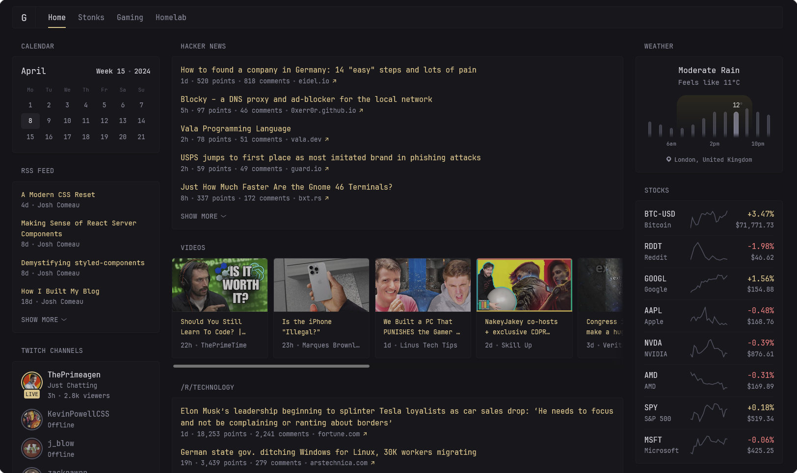
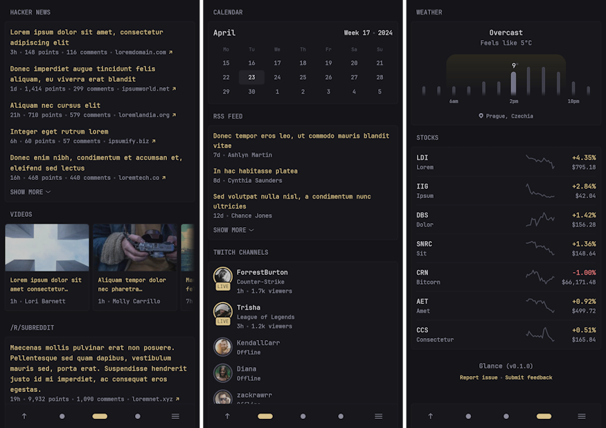
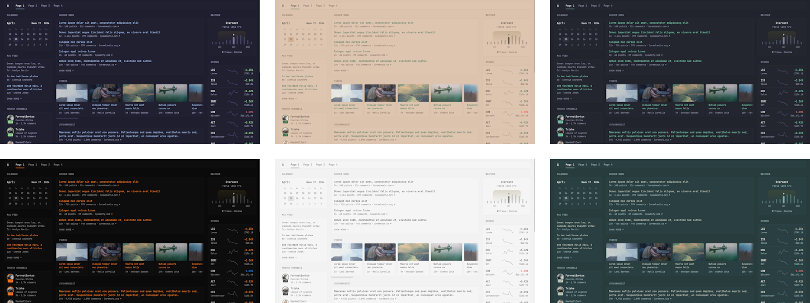

<p align="center"><a href="README.md">English</a> | <a href="README.zh-CN.md">简体中文</a></p>

<p align="center"></p>
<h1 align="center">Glance</h1>
<p align="center">
  <a href="#安装">安装</a> •
  <a href="docs/configuration.md#configuring-glance">配置</a> •
  <a href="https://discord.com/invite/7KQ7Xa9kJd">Discord</a> •
  <a href="https://github.com/sponsors/glanceapp">赞助</a>
</p>
<p align="center">
  <a href="https://github.com/glanceapp/community-widgets">社区组件</a> •
  <a href="docs/preconfigured-pages.md">预配置页面</a> •
  <a href="docs/themes.md">主题</a>
</p>

<p align="center">一个轻量、高度可定制的仪表盘，以美观简洁的界面<br>展示你的信息流</p>



## 功能特性
### 各种组件
* RSS 订阅源
* Subreddit 帖子
* Hacker News 帖子
* 天气预报
* YouTube 频道更新
* Twitch 频道
* 市场行情
* Docker 容器状态
* 服务器状态
* 自定义组件
* [以及更多……](docs/configuration.md#configuring-glance)

### 快速而轻量
* 低内存占用
* 依赖少
* 极简的原生 JS
* 单个不足 20mb 的可执行文件，支持多种操作系统和架构，Docker 容器也同样小巧
* 未缓存的页面通常也能在约 1s 内加载完成（取决于网络速度和组件数量）

### 高度可定制
* 不同的布局
* 根据需要任意数量的页面/标签页
* 每个组件都有丰富的配置选项
* 部分组件支持多种样式
* 自定义 CSS

### 针对移动设备优化
因为你会想把它带在身边，随时使用。



### 支持主题
只需微调几个数值即可轻松创建自己的主题，也可以直接从[现有主题](docs/themes.md)中挑选。



<br>

## 配置
配置通过 YAML 文件完成。要了解布局的工作原理、如何添加更多页面以及如何配置组件，请参阅[配置文档](docs/configuration.md#configuring-glance)。
<details>
<summary><strong>预览示例配置文件</strong></summary>
<br>

```yaml
pages:
  - name: Home
    columns:
      - size: small
        widgets:
          - type: calendar
            first-day-of-week: monday

          - type: rss
            limit: 10
            collapse-after: 3
            cache: 12h
            feeds:
              - url: https://selfh.st/rss/
                title: selfh.st
                limit: 4
              - url: https://ciechanow.ski/atom.xml
              - url: https://www.joshwcomeau.com/rss.xml
                title: Josh Comeau
              - url: https://samwho.dev/rss.xml
              - url: https://ishadeed.com/feed.xml
                title: Ahmad Shadeed

          - type: twitch-channels
            channels:
              - theprimeagen
              - j_blow
              - piratesoftware
              - cohhcarnage
              - christitustech
              - EJ_SA

      - size: full
        widgets:
          - type: group
            widgets:
              - type: hacker-news
              - type: lobsters

          - type: videos
            channels:
              - UCXuqSBlHAE6Xw-yeJA0Tunw # Linus Tech Tips
              - UCR-DXc1voovS8nhAvccRZhg # Jeff Geerling
              - UCsBjURrPoezykLs9EqgamOA # Fireship
              - UCBJycsmduvYEL83R_U4JriQ # Marques Brownlee
              - UCHnyfMqiRRG1u-2MsSQLbXA # Veritasium

          - type: group
            widgets:
              - type: reddit
                subreddit: technology
                show-thumbnails: true
              - type: reddit
                subreddit: selfhosted
                show-thumbnails: true

      - size: small
        widgets:
          - type: weather
            location: London, United Kingdom
            units: metric
            hour-format: 12h

          - type: markets
            markets:
              - symbol: SPY
                name: S&P 500
              - symbol: BTC-USD
                name: Bitcoin
              - symbol: NVDA
                name: NVIDIA
              - symbol: AAPL
                name: Apple
              - symbol: MSFT
                name: Microsoft

          - type: releases
            cache: 1d
            repositories:
              - glanceapp/glance
              - go-gitea/gitea
              - immich-app/immich
              - syncthing/syncthing
```
</details>

<br>

## 安装

选择以下安装方式之一：

<details>
<summary><strong>Docker compose：使用提供的目录结构（推荐）</strong></summary>
<br>

运行以下命令，创建一个名为 `glance` 的新目录，并在其中生成模板文件：

```bash
mkdir glance && cd glance && curl -sL https://github.com/glanceapp/docker-compose-template/archive/refs/heads/main.tar.gz | tar -xzf - --strip-components 2
```

*[点击此处查看将创建的文件](https://github.com/glanceapp/docker-compose-template/tree/main/root)*

然后，根据需要编辑以下文件：
* `docker-compose.yml` 用于配置端口、卷以及其他容器相关设置
* `config/home.yml` 用于配置主页的组件或布局
* `config/glance.yml` 用于更换主题或添加更多页面

<details>
<summary>你可能还想编辑的其他文件</summary>

* `.env` 用于配置配置文件中可用的环境变量
* `assets/user.css` 用于添加自定义 CSS
</details>

准备就绪后，运行：

```bash
docker compose up -d
```

如果遇到问题，可以通过以下命令查看日志：

```bash
docker compose logs
```

<hr>
</details>

<details>
<summary><strong>Docker compose：手动创建</strong></summary>
<br>

创建包含以下内容的 `docker-compose.yml` 文件：

```yaml
services:
  glance:
    container_name: glance
    image: glanceapp/glance
    restart: unless-stopped
    volumes:
      - ./config:/app/config
    ports:
      - 8080:8080
```

然后，创建一个 `config` 目录，并将示例起始 [`glance.yml`](https://github.com/glanceapp/glance/blob/main/docs/glance.yml) 文件下载到其中：

```bash
mkdir config && wget -O config/glance.yml https://raw.githubusercontent.com/glanceapp/glance/refs/heads/main/docs/glance.yml
```

可随意按自己的喜好编辑 `glance.yml` 文件，准备就绪后运行：

```bash
docker compose up -d
```

如果遇到问题，可以通过以下命令查看日志：

```bash
docker logs glance
```

<hr>
</details>

<details>
<summary><strong>手动安装二进制文件</strong></summary>
<br>

提供适用于 Linux、Windows 和 macOS 的预编译二进制文件（x86、x86_64、ARM 和 ARM64 架构）。

### Linux

访问[最新发布页面](https://github.com/glanceapp/glance/releases/latest)获取可用的二进制文件。你可以将二进制文件放到 `/opt/glance/` 目录，并通过 [systemd 服务](https://linuxhandbook.com/create-systemd-services/)让它随服务器启动。默认情况下，运行二进制文件时，Glance 会在其所在目录中查找 `glance.yml` 文件。要指定其他路径的配置文件，请使用 `--config` 选项：

```bash
/opt/glance/glance --config /etc/glance.yml
```

要获取配置文件的起始模板，请运行：

```bash
wget https://raw.githubusercontent.com/glanceapp/glance/refs/heads/main/docs/glance.yml
```

### Windows

从[最新发布页面](https://github.com/glanceapp/glance/releases/latest)下载可执行文件并解压（64 位系统最可能是名为 `glance-windows-amd64.zip` 的文件），然后放到你选择的文件夹中。

接着，在同一目录下创建一个名为 `glance.yml` 的文本文件，并将[此处](https://raw.githubusercontent.com/glanceapp/glance/refs/heads/main/docs/glance.yml)的内容粘贴进去。之后你就可以运行该可执行文件，并通过浏览器访问 `http://localhost:8080` 来使用仪表盘。


<hr>
</details>

<details>
<summary><strong>其他方式</strong></summary>
<br>

Glance 也可以通过以下第三方渠道安装：
* [Proxmox VE Helper Script](https://community-scripts.org/scripts/glance?id=glance)
* [NixOS package](https://search.nixos.org/packages?channel=unstable&show=glance)
* [Hostinger](https://www.hostinger.com/vps/docker/glance)
* [Coolify.io](https://coolify.io/docs/services/glance/)

<hr>
</details>

<br>

## 常见问题
<details>
<summary><strong>请求超时</strong></summary>

最常见的原因是使用了 Pi-Hole、AdGuard Home 等广告拦截 DNS 服务，它们默认设置了相当低的速率限制。如果单个页面中的组件数量较多，这个限制很容易被超出。要解决此问题，请在你的 DNS 服务设置中提高速率限制。

如果使用 Podman，极少数情况下的超时可能由一个未知问题导致，可以尝试将以下内容添加到 `docker-compose.yml` 文件末尾来解决：
```yaml
networks:
  podman:
    external: true
```
</details>

<details>
<summary><strong>markets、bookmarks 等组件布局错乱</strong></summary>

这几乎总是由浏览器扩展 Dark Reader 引起的。要解决此问题，请在托管 Glance 的域名上禁用暗色模式。
</details>

<details>
<summary><strong>cannot unmarshal !!map into []glance.page</strong></summary>

最常见的原因是：你的 `glance.yml` 中有一个 `pages` 键，同时在你包含的某个页面文件中也有一个 `pages` 键。要解决此问题，请删除被包含页面顶部的 `pages` 键。

</details>

<br>

## 常见问题解答
<details>
<summary><strong>页面上的信息会自动更新吗？</strong></summary>
不会，需要刷新页面才能更新信息。有些内容会在合适的情况下动态更新，例如时钟组件，以及显示某事发生了多久的相对时间。
</details>

<details>
<summary><strong>组件多久更新一次？</strong></summary>
后台不会定期发起请求，信息只在页面加载时获取，随后进行缓存。每个组件的默认缓存时长各不相同，且可以进行配置。
</details>

<details>
<summary><strong>我可以创建自己的组件吗？</strong></summary>

可以，有多种创建自定义组件的方式：
* `iframe` 组件——允许你嵌入其他网站的内容
* `html` 组件——允许你插入自己的静态 HTML
* `extension` 组件——从一个 URL 获取 HTML
* `custom-api` 组件——从一个 URL 获取 JSON 并使用自定义 HTML 渲染
</details>

<details>
<summary><strong>我可以修改组件的标题吗？</strong></summary>

可以，所有组件的标题都可以通过在组件配置中指定 `title` 属性来修改：

```yaml
- type: rss
  title: My custom title

- type: markets
  title: My custom title

- type: videos
  title: My custom title

# and so on for all widgets...
```
</details>

<br>

## 功能请求

欢迎随时提出新功能建议，我们都会认真考虑，但请记住其中一些建议可能超出项目正在追求（或合理所能达到）的目标范围。如果你有新功能的想法并想分享，可以在[此处](https://github.com/glanceapp/glance/issues/new?template=feature_request.yml)提交。

功能请求会被标记为以下类型之一：

* [Roadmap](https://github.com/glanceapp/glance/labels/roadmap)——将在未来的版本中实现
* [Backlog](https://github.com/glanceapp/glance/labels/backlog)——未来可能实现，但需要更多的反馈或社区兴趣
* [Icebox](https://github.com/glanceapp/glance/labels/icebox)——暂不打算实现，因为目前与项目的目标或能力不符，未来可能会重新评估

<br>

## 从源码构建

选择以下方式之一：

<details>
<summary><strong>使用 Go 构建二进制文件</strong></summary>
<br>

要求：[Go](https://go.dev/dl/) >= v1.23

要为当前操作系统和架构构建项目，请运行：

```bash
go build -o build/glance .
```

要为特定操作系统和架构构建，请运行：

```bash
GOOS=linux GOARCH=amd64 go build -o build/glance .
```

[*点击此处查看完整的 GOOS/GOARCH 组合列表*](https://go.dev/doc/install/source#:~:text=$GOOS%20and%20$GOARCH)

如果你只是想运行应用而不生成二进制文件（比如在测试改动时），也可以运行：

```bash
go run .
```
<hr>
</details>

<details>
<summary><strong>使用 Docker 构建项目和镜像</strong></summary>
<br>

要求：[Docker](https://docs.docker.com/engine/install/)

要仅使用 Docker 构建项目和镜像，请运行：

*（将 `owner` 替换为你的名称或组织名）*

```bash
docker build -t owner/glance:latest .
```

如果希望将镜像推送到镜像仓库（默认为 Docker Hub），可以运行：

```bash
docker push owner/glance:latest
```

<hr>
</details>

<br>

## 贡献指南

* 在开发新功能之前，建议先提交一个功能请求，并说明你希望自己实现它
* 请不要为已标记为 roadmap<sup>[1]</sup>、backlog<sup>[2]</sup> 或 icebox<sup>[3]</sup> 的功能请求提交 PR
* 添加新功能或修复缺陷时，请使用 `dev` 作为基础分支，其他情况请使用 `main`
* 避免引入新依赖
* 避免做出向后不兼容的配置变更
* 避免引入新颜色或硬编码颜色，请使用标准的 `primary`、`positive` 和 `negative`
* 图标请尽量使用 [heroicons](https://heroicons.com/)
* 如果涉及 UI 变更，请尽可能提供改动截图
* 不要添加 `package.json`

<details>
<summary><strong><sup>[1] [2] [3]</sup></strong></summary>

[1] 该功能很可能已有正在进行的工作，可能与你的实现冲突

[2] 需求、实现或功能尚不明确

[3] 目前没有添加该功能的计划

</details>

<br>

## 致谢

感谢所有慷慨[赞助](https://github.com/sponsors/glanceapp)本项目的朋友，也感谢每一位以任何方式做出贡献的人——无论是提交 PR、反馈问题、在讨论区或 Discord 服务器中帮助他人、编写指南和工具，还是在社交媒体上提及 Glance。非常感谢大家的支持，这是项目持续前进的动力。
